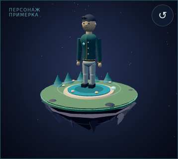
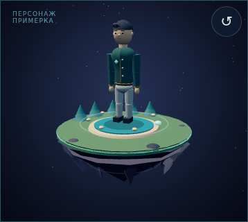
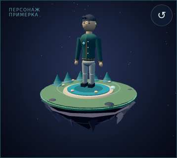

# HUMAN OS / Health Console — персонаж и метрический стандарт v1.0
Дата: 27 октября 2026, Москва.
Цель: персонаж в стилистике островов, который отражает изменения данных.
Этап: реализовано и опубликовано в публичном демонстрационном модуле.
Текущая задача: пользовательская художественная приёмка и проверка на физическом iPhone.
Прогресс HUMAN OS: 92% — оценка визуального этапа мира, не готовность защищённого продукта здоровья.

## Результат
Крупный одетый персонаж стоит на небольшой парящей платформе. Камень, вода, растительность, свет и матовые материалы основаны на словаре мира островов `993b3e19ee46388cb4d0262629c90d39afd9bb47`.
Внешность — базовый стилизованный герой. Фотографии лица в этой итерации не загружались; портретное сходство с пользователем не заявляется. Пульс, сон или вес сами по себе не определяют черты лица.
Лицо, причёска и возрастное впечатление не меняются по измерениям. Настроение может менять выражение, энергия — позу. При изменении роста форма головы сохраняется, камера автоматически удерживает её в безопасной зоне.

## Источники и границы
- Используются уже сохранённые в браузере `records/checkins`, локально импортированный JSON и явно введённый рост.
- При отсутствии любых локальных данных применяется явно обозначенный DEMO.
- Если есть локальные данные, отсутствующие измерения не подменяются демозначениями.
- Примерка меняет только вымышленную энергию. Она не перезаписывает измерения, настроение, дискомфорт или профиль.
- Сервер отдаёт код и не хранит измерения. Источники, даты, единицы и значения исходных записей остаются локально.
- У модели нет единого балла здоровья и заключений «здоров/болен». Шкалы ниже — правила интерфейсной визуализации, не медицинские нормы.

## Периоды и достаточность данных
Текущий уровень веса, доли жира и безжировой массы — медиана последних 7 календарных дат (возраст записи 0–6 дней), минимум 3 даты.
Исходный уровень — медиана предыдущих 28 дат, без этих последних 7 дней (возраст 7–34 дня), минимум 7 дат.
Медиана — срединное значение упорядоченного ряда; при чётном числе значений берётся среднее двух средних. Она уменьшает влияние одиночного скачка. Повторные измерения одной даты сначала объединяются медианой.
Недостаток истории означает отсутствие сравнительной категории; исходный уровень не выдумывается.
Прямые свежие значения пульса и дыхания можно анимировать без исходного уровня.
Даты в текущем формате имеют точность до календарного дня; точное время измерения из них не восстанавливается.

## Категории и визуальные каналы
Процент изменения: `Δ = (текущий − исходный) / исходный × 100%`.
Процентный пункт: разница двух значений, уже выраженных в процентах. Например, 20% → 24% = +4 п.п.

| Канал | Единица | Метрическая шкала | Визуальное отображение |
|---|---|---|---|
| Вес | кг; изменение в % | менее −5%; от −5 до −2%; от −2 до +2%; свыше +2 до +5%; свыше +5% | Ширина торса и бёдер; центральная зона не меняет силуэт |
| Доля жира | %; изменение в п.п. | менее −3; от −3 до −1; от −1 до +1; свыше +1 до +3; свыше +3 п.п. | Условный объём талии |
| Безжировая масса | кг; изменение в % | Те же пять зон ±2/±5% | Плечи и руки; не называется прямым измерением мышц |
| Рост | см, явно заданный | Допустимый диапазон ввода модели 100–230 см | Вертикальные пропорции тела; лицо не растягивается |
| Энергия, самооценка | 1–10 | 1–3 / 4–6 / 7–10 | Собранность позы, положение рук, раскрытие глаз |
| Настроение, самооценка | 1–10 | 1–3 / 4–6 / 7–10 | Брови и нейтральное/мягко улыбающееся выражение |
| Дискомфорт в колене, самооценка | 0–10 | 0 / 1–3 / 4–6 / 7–10 | Сдержанный симметричный маркер; сторона и диагноз не определяются |
| Активность | шаги; отношение к своему уровню | менее 50%; 50–85%; 85–115%; свыше 115 до 150%; более 150% | Скорость декоративного контура на платформе |
| Сон | часы; отношение к своему уровню | Та же шкала 50/85/115/150% | Отдельная дуга; настроение из сна не вычисляется |
| Пульс покоя / пульс | уд/мин | Ритм = значение / 60; сравнение по зонам ±10/±20% личного уровня | Мягкий ритм света на груди, без тревожной оценки |
| Дыхание | вдохов/мин | Ритм = значение / 60; сравнение ±10/±20% | Небольшое движение грудной клетки |
| SpO₂ | % | Прямое значение 0–100%; сравнение в п.п. | Заполнение отдельной дуги; без «здоров/болен» |
| Походка | скорость в м/с; показатели в % | Скорость — отношение к своей медиане; проценты — разница в п.п. | Темп и симметричный общий индикатор, без выдуманной повреждённой стороны |

Все дополнительные входы — дистанция, активная и базовая энергия, тренировки, этажи, длина шага, двойная опора, ИМТ и аудионагрузка — описаны в машинном контракте. Не каждому числу назначается анатомический эффект: ИМТ не меняет тело повторно, калории не превращаются автоматически в изменение веса, дБ сравниваются разницей, а не отношением.

## Ограничители морфинга
- Вес: `ширина = clamp(1 + 0,6 × Δвеса, 0,92, 1,08)`.
- Талия: `clamp(1 + 0,012 × Δжира_п.п., 0,92, 1,08)`.
- Плечи: `clamp(1 + 0,7 × Δбезжировой_массы, 0,94, 1,06)`.
- Это условная стилизованная пластика, не восстановление реальных обмеров по весам.
- Рост масштабируется относительно технического размера рига 175 см с художественным ограничением ±15%. Число 175 не является ростом пользователя или «идеальным ростом».
- Лицо компенсирует вертикальный масштаб тела и сохраняет геометрию.
- Границы имеют гистерезис: 0,5 процентного пункта для относительных шкал; 0,2 п.п. для разностей. Это предотвращает дрожание категории около порога.
- Переходы сглажены примерно до 95% цели за секунду при обычной частоте кадров. При системном уменьшении движения переходы мгновенные, декоративные пульсации отключены.
- Световой ритм ограничен 0,5–2,2 Гц, дыхательная анимация — 0,08–0,6 Гц. Это ограничение эффекта, а не изменение сохранённого измерения.
- Безжировая масса выше общей массы помечается как конфликт: зависимый морфинг состава тела отключается.

## Отсутствие и качество данных
| Состояние | Правило | Отображение |
|---|---|---|
| MISSING | Нет записи | Нейтральная форма/контур, без нулевой оценки |
| INVALID | Некорректная дата/число, будущее или невозможный процент >100 | Зависимый эффект отключён |
| STALE | Старше срока отображения | Нейтральный контур, отметка об устаревании |
| INSUFFICIENT | Не хватает дат для сравнения | Нет сравнительного морфинга; прямой свежий пульс может отображаться |
| FRESH | Достаточная свежая информация | Разрешён соответствующий визуальный канал |

Технические сроки: вес — до 14 календарных дней; состав тела и ИМТ — до 30; явно измеренный рост — до 365; остальные измерения — текущая или предыдущая календарная дата. Самооценки действуют только на текущую дату. Эти сроки относятся к актуальности визуализации и не являются медицинскими рекомендациями по частоте измерений.

## Интерфейс
Раздел «Персонаж · шкалы и параметры» расположен под основной сценой, без крупного текста поверх мира.
В нём показаны значения, исходный уровень и категории; доступны рост, три энергетические примерки и возврат «Из данных».
На самой сцене виден только источник: ДЕМО / ЛОКАЛЬНЫЕ ДАННЫЕ / ПРИМЕРКА.
Режим примерки явный; его нельзя принять за результат реального измерения.

## Проверки и публикация
Код: `11361250062c41d037c0b516315db8f259e7915d`.
[CI 40468117401 — SUCCESS](https://github.com/mkontrakevich/GPT/actions/runs/40468117401).
[PNG и протокол](https://github.com/mkontrakevich/GPT/actions/runs/40468117401/artifacts/12717965048).
33 теста и 20 браузерных профилей Chromium/WebKit.
Проверены единицы, медианы, выбросы, пропуски, устаревание, ошибочные значения, границы категорий, отсутствие повторного влияния ИМТ, противоречивый состав тела и неизменность записей в примерке.
Браузеры подтвердили 3D, переключение модулей, поворот/масштабирование, восстановление WebGL, изменение позы, локальный рост, безопасную зону головы и морфинг после импорта синтетического ряда.
После публикации основной адрес повторно отрисован при 390×700: WebGL активен, 84 объекта геометрии, 84 вызова отрисовки в контрольном кадре, ошибок нет. Это не FPS физического iPhone.

Адрес: https://health-game-console-mvp.kontrakevich.workers.dev/?v=0.5-avatar
Версия: preview-v0.5-avatar.
Cloudflare: `20f83489-153e-4f0c-9a23-8edfd2637906`.
Откат: `7c881f1c-230b-4d3c-afbd-27ef570ae3b3`.
Резервная ветка: `backup/health-console-before-island-20261027`.
Полная готовность защищённого продукта и физическая Safari-приёмка не заявляются.

## Изображения
Все три изображения ниже — явная примерка энергии. Они не являются личными измерениями пользователя.

## Общий стандарт и экономика
Единый источник расчёта: `avatar/metric-engine.mjs`. 3D принимает только производные визуальные параметры. Синхронизация встроенного кода проверяется тестами.
JSON-контракт сохраняет единицы, границы и эффект каждого канала; его можно использовать в других модулях HUMAN OS без дублирования медицинской логики.
Бизнес-ценность — понятная связь показателя и игрового отображения, единая стилистика и повторно используемый локальный механизм.
Подтверждённых человеко-часов и выручки нет. Платная генерация изображений/видео не запускалась.
