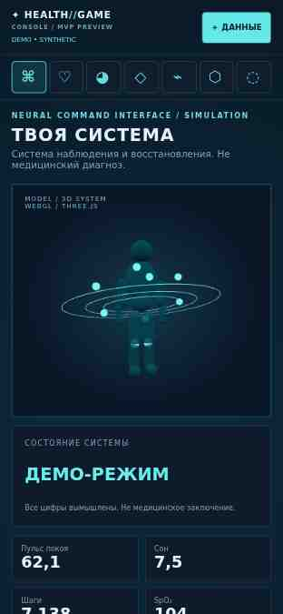
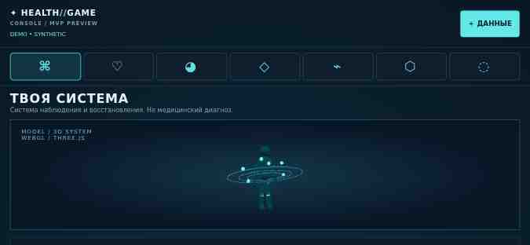
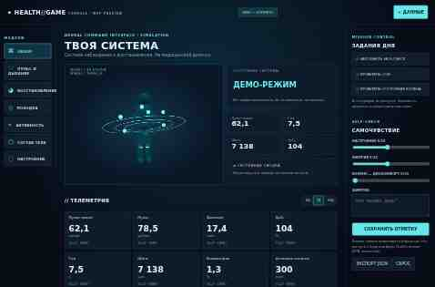

# HUMAN OS / Health Console — исправление мобильной навигации
Дата: 27 октября 2026, Москва.
Цель: сделать 3D и навигацию доступными в первом экране телефона.
Этап: исправление опубликовано, повторно проверено на основном адресе.
Текущая задача: получить повторное подтверждение на физическом iPhone пользователя.
Прогресс мира HUMAN OS: 92% — предыдущая оценка визуального этапа, не готовность Health Console.

## Наблюдение и причина
На присланном скриншоте открыт Health Console, связанный с островом здоровья.
Пустая область оказалась контейнером навигации. В мобильном CSS горизонтальный flex был установлен на внешнем nav, но его единственный дочерний #nav продолжал содержать семь блочных кнопок.
Поэтому кнопки стояли столбцом, высота навигации достигала 423 px, а 3D начинался только с 625 px.
Загрузка Three.js была исправна; сцена находилась ниже.

## Исправление
- Горизонтальная раскладка перенесена на реальный контейнер кнопок #nav.
- Убрана ширина 100% у каждой мобильной кнопки, сохранены семь модулей и области касания не меньше 44×44 px.
- Шапка перестроена общей двухколоночной сеткой; кнопка «Данные» не растягивается по высоте.
- Учтены безопасные отступы iPhone и малая высота горизонтального экрана.
- Добавлены текстовые доступные названия и состояние выбранной кнопки.
- CSS исправлен в существующих адаптивных правилах, без сокрытия глобального переполнения.
- Код хранения записей и происхождение адреса не менялись; личные записи остаются в том же браузере.

## Измерения
| Показатель, 390×844 | До | После |
|---|---:|---:|
| Высота навигации | 423 px | 61 px |
| Начало сцены от верха страницы | 625 px | 253 px |
| Нижняя граница сцены | 945 px | 573 px |

На уменьшенном экране 390×700 нижняя граница сцены — 519 px.
В горизонтальном профиле 844×390 сцена помещается между 190 и 366 px.
В опубликованной версии: WebGL / THREE.JS, семь модулей, горизонтального переполнения страницы нет.

## Проверки
[GitHub Actions 40462722731 — SUCCESS](https://github.com/mkontrakevich/GPT/actions/runs/40462722731).
[Артефакт PNG и протокол](https://github.com/mkontrakevich/GPT/actions/runs/40462722731/artifacts/12715287261).
Проверен код `9ca39491fcc6034b26dbfe343fc32530a6c83dc4`.
Chromium и WebKit: по 10 размеров — 320×740, 390×844, 430×932, 600×900, 768×1024, 844×390, 1024×768, 1366×900, 1440×900, 1920×1080.
Проверены WebGL, семь переключений модулей, доступные названия, размеры кнопок, отсутствие переполнения, верх/середина/низ страницы, CSS-масштабы 80/90/100/125%, резервная навигация при отказе CDN, отсутствие ошибок страницы.
CSS-масштаб в автоматизации не заменяет ручную проверку системного масштабирования браузера.
WebKit в Linux CI не приравнивается к физическому iPhone Safari.
После публикации основной адрес повторно проверен облачным Chromium при 390×700.

## Публикация и откат
Адрес: https://health-game-console-mvp.kontrakevich.workers.dev/?v=0.3-mobile
Версия: preview-v0.3-mobile.
Cloudflare version: `7c881f1c-230b-4d3c-afbd-27ef570ae3b3`.
Предыдущая версия для отката: `0c13f505-66d3-43a5-a024-7e7b3656acfb`.
Резервная ветка: `backup/health-console-before-mobile-20261027`.
Испытательный Worker: `health-console-mobile-fix`.
Основной мир HUMAN OS и его версии в этой итерации не публиковались.
Issue #15 и PR #14 остаются открытыми: личная защищённая интеграция данных и физические устройства — отдельные условия полного выпуска.

## Визуальные доказательства
Обзорные JPEG ниже получены с испытательного Worker; в основной Worker опубликован идентичный исполняемый код. Полные PNG сохранены в артефакте CI.

## Управленческая фиксация
Бизнес-ценность: сцена и навигация видны без лишней прокрутки, устранён воспроизводимый дефект мобильного пути из HUMAN OS.
Фактические человеко-часы не измерялись; трудозатраты сотрудника не выдумываются.
Платные генерации изображений и видео не выполнялись.
Полная готовность проектов до 100% не заявляется.
