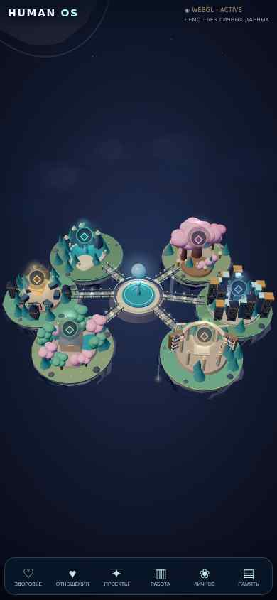
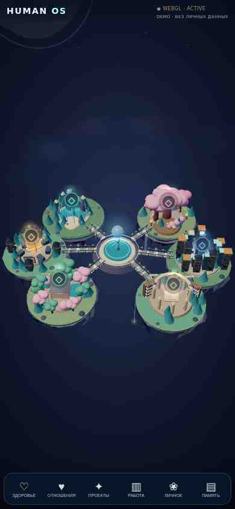
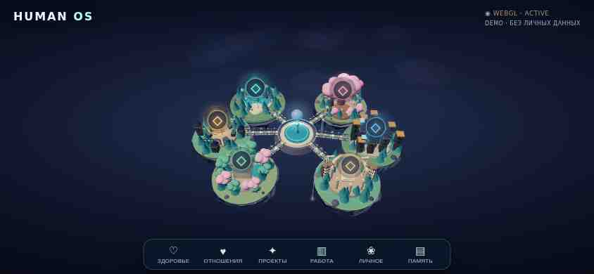
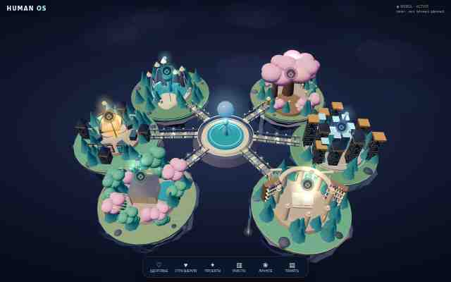

# HUMAN OS — WebGL Living World
Дата: 27 октября 2026, Москва.
Цель: довести шесть островов до проверенного визуального релиза.
Этап: v0.5 на испытательном сайте; основной сайт сохраняет v0.4.
Текущая задача: завершить автоматизированные проверки и закрыть оставшиеся условия выпуска.
Прогресс: 92% — оценка визуального этапа. Это не готовность всей HUMAN OS и не число успешно пройденных тестов.

## Восстановленное состояние
Продолжена ветка `feat/human-os-cinematic-assets`, PR #19 и Issue #18. Проект не пересоздавался.
Последняя исходная точка: `987d40c6c694bf8765501ae6a54423e8575fac22`; подтверждённый успешный CI: 40403591179.
Эталон графики v0.3: `2f9d0b1650c2e7cab54d09d1332c71f0050935f6`.
Резервная ветка: `backup/human-os-v0.4-20261027`.
Основной сайт: https://human-os-living-world.kontrakevich.workers.dev/
Испытательный сайт: https://human-os-cinematic-v3.kontrakevich.workers.dev/

## Реализованные изменения
1. Добавлены шесть отдельных glTF-моделей — переиспользуемых файлов трёхмерной геометрии: аркада святилища, ветви дерева, орбитальная конструкция вокруг кристалла, наблюдательный шпиль, садовая пергола, страницы раскрытой книги.
2. Все модели оригинальные, параметрически построенные; сторонние модели и платные генерации не использовались. Суммарный объём — около 230 КБ. Это дополнительный слой деталей; завершённая библиотека высококачественных фактурных активов пока не заявляется.
3. Статичная непрозрачная геометрия объединена по островам и материалам. Сохранены детали, выбор островов, анимация, прозрачные эффекты и пакетная отрисовка растительности.
4. Исправлен центр вращения камеры при фокусе. Переходы учитывают прошедшее время; вращение и масштабирование разделены.
5. Обработаны отмена жеста, изменение ориентации, ограничение плотности пикселей, системное предпочтение уменьшенного движения.
6. Добавлено восстановление после потери контекста WebGL — доступа браузера к графическому процессору.
7. Добавлена диагностика реальных вызовов отрисовки, треугольников, времени кадра и ошибок загрузки. Больших текстовых блоков поверх мира не добавлено.

## Измерения
Сравнение выполнено при 390×844 в облачном Chromium с программной графикой, последовательно на стабильной и новой версиях.

| Показатель | v0.4 | v0.5 | Изменение |
|---|---:|---:|---:|
| Объекты геометрии в сцене | 917 | 213 | −77% |
| Вызовы отрисовки за кадр | 966 | 262 | −73% |
| Медианное время кадра в одном сравнительном замере | 133,3 мс | 100,0 мс | −25% |

Вызов отрисовки — отдельная команда браузера графическому процессору. Время кадра — длительность подготовки и показа одного изображения; 30 кадров/с соответствует примерно 33,3 мс на кадр.
Эти числа относятся к облачной программной графике. Частота кадров заметно меняется между облачными сессиями. Это не измерение производительности iPhone и не доказательство достижения 30 кадров/с.

## Проверки на испытательном сайте
- WebGL ACTIVE при 390×844, 844×390 и 1280×800.
- Все шесть моделей загружены, ошибок моделей в штатном режиме нет.
- Выбор всех шести островов, фокус камеры и возврат подтверждены облачными проверками; последняя полная проверка обновлённой версии выполнена в портретном и горизонтальном профилях.
- Принудительная потеря и восстановление контекста: 1 потеря, 1 восстановление, возврат в ACTIVE.
- При блокировке CDN доступны двухмерный режим, шесть кнопок и ссылка Health.
- При блокировке моделей остаются базовый трёхмерный мир, навигация и переходы.
- Проверки GitHub Actions расширены: синтаксис, маршруты Worker, реальные буферы моделей, валидатор Khronos, браузерные снимки, жесты и восстановление контекста.
- WebKit в автоматизации — движок браузера, а не Safari на физическом iPhone. Firefox в Linux — не Firefox на Windows.

## Сравнение графики
Силуэты островов, центральный узел, мосты, растительность, базовые материалы и свет сохранены.
Исправлено перекрытие нижних островов меню в горизонтальном режиме.
JPEG ниже — обзорные доказательства; изображения рабочего интерфейса GitHub Actions сохраняются отдельным артефактом в PNG.

### Исходная мобильная v0.4

### Мобильная v0.5

### Горизонтальное кадрирование v0.5

### Десктопная v0.5

## Экономика и востребованность
Прямая ценность: уменьшение нагрузки отрисовки и повторное использование отдельных моделей; сокращение стоимости последующих итераций.
Подтверждённый заказчик демонстрационного мира — пользователь. Данных о выручке, конверсии или массовом использовании нет.
Фактические человеко-часы не измерены; время работы ассистента не приравнивается к трудозатратам сотрудника.
Платные генерации изображений и видео в этой итерации не запускались.

## Сохранение и откат
Основной Worker сохраняет версию `45c4d7d4-c336-4675-acf4-4d68d8cf0cee`.
Исходная версия испытательного Worker: `0318da52-4272-4abf-8dc9-74e1009b5d33`.
Перенос на основной Worker заблокирован до выполнения условий выпуска.
Откат выполняется выбором сохранённой версии на 100% трафика через Cloudflare Deployments. Перед откатом необходимо сверить актуальную версию; удалять Worker не требуется.
Повторяемая сборка: `node human-os-webgl/tools/build-worker.mjs`.
Она собирает `dist-worker.mjs` и каталог `dist`; инфраструктура GitHub + Cloudflare сохранена.

## Что остаётся до 100%
- Сохранить актуальную проверку кода при следующих изменениях; физические устройства и Firefox WebGL остаются отдельными условиями выпуска.
- Провести независимую художественную проверку фактур, материалов, освещения и каждого острова крупным планом. Наличие glTF-файлов само по себе не означает высокого художественного качества.
- Измерить частоту кадров на физическом iPhone, проверить Safari: касание, вращение, масштабирование, фокус, возврат, поворот экрана, уход приложения в фон и возврат.
- Проверить Chromium и Firefox на Windows.
- Получить окончательную художественную приёмку относительно утверждённой концепции.
- После выполнения условий перенести на основной Worker с проверкой состояния и возможностью отката.

Issue #18 остаётся открытым, PR #19 — черновиком. Реальные персональные данные и интеграция HROS/Health в этот публичный мир не добавлялись.

## Подтверждённые результаты автоматизации
Исходный код с моделями: `3f1b030e52a3953c27ffd6e670b9479a8d89d6ac`.
GitHub Actions: [успешный прогон 40407956142](https://github.com/mkontrakevich/GPT/actions/runs/40407956142).
[Артефакт: PNG, протокол браузеров и проверка моделей](https://github.com/mkontrakevich/GPT/actions/runs/40407956142/artifacts/12691299478).

| Движок в Linux CI | 390×844 | 844×390 | 1280×800 | Потеря и восстановление WebGL |
|---|---|---|---|---|
| Chromium | 3D PASS | 3D PASS | 3D PASS | PASS во всех трёх |
| WebKit | 3D PASS | 3D PASS | 3D PASS | PASS во всех трёх |
| Firefox | Резервный режим | Резервный режим | Резервный режим | 3D не проверен |

В Chromium отдельно прошли реальные браузерные события масштабирования двумя касаниями, перетаскивания, отмены указателя и смены ориентации.
Khronos Validator: все шесть моделей — **0 ошибок, 0 предупреждений**.
Итог SUCCESS означает прохождение заявленных автоматических проверок; он не превращает резервный режим Firefox в успешный тест 3D.
Последняя версия испытательного Worker после уточнения границ буферов моделей: `6c93fd20-1da5-40cc-97ed-7667c0ab945b`.
Доступность файлов подтверждена повторными GET-запросами; размеры и SHA-256 фактических ответов сохранены в `evidence/deployed-assets.json`.
Следующая корректировка касалась соответствия заголовков безопасности статической сборки и запуска CI; основной WebGL-код и модели не менялись.

## Итог последней проверки инфраструктурной сборки
Коммит исполняемой части: `77c77d74cc9bce2601466177002116dd2cf24049`.
[Последний полный CI 40408517082](https://github.com/mkontrakevich/GPT/actions/runs/40408517082) — SUCCESS, включая соответствие сборки, Khronos и браузерную матрицу.
Документальные изменения после этого коммита не меняют сцену и не запускают повторную браузерную сборку.
